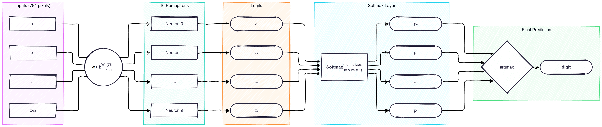

## Guide on Neural Networks

### The Perceptron

A single perceptron:
- takes 784 inputs (MNIST image size is 28x28 = 784 pixels)
- has 784 weights and one bias. 
- calculates a single number `z = WX + b` (actually X * W + b since we need to match the shapes)
- can answer a single binary question (e.g. is this digit 0 or not?)

Because we need to clasify 10 digits, we can say we need 10 perceptrons in this neural network. Each one has 784 weights and 1 bias, producing score z_i. The formulas are no different because W has a shape of (784, 10) - 784 rows for each pixel and 10 columns for each different perceptron and the bias has a shape of (10,) - 10 elements for each perceptron.

### The Flow


We can see in the diagram that the NN has 784 input nodes (pixels of 1 image) and exactly 10 output nodes (one for each class).

### Activation Function
The original Rosenblatt Perceptron used a hard step function {-1, 1} and because the derivative of that would be 0 everywhere, it can't use loss functions or gradient descent. Here we can use softmax as an activation function and cross-entropy for calculating loss, making this more like a softmax regression model (or multinomial regression model).

The **Softmax** function converts a raw vector of logits $z = [z1, .., z_k]$ and computes a probability distribution for each of the classes $\hat{y} = [\hat{y_1}, .., \hat{y_k}]$.
$$ \hat{y_i} = \frac{e^{z_i}}{\sum^k_{j=1} e^{z_j}} $$

This is the equivalent to:
```py
def softmax(z):
    z = z - np.max(z, axis=-1, keepdims=True)
    
    expsum = np.sum(np.exp(z), axis=-1, keepdims=True)
    return np.exp(z) / expsum
```
*Note: for a stable softmax a numerical stabilization is recommended.*

### Loss Function 
The Cross-Entropy function measure the difference between a model's predicted probability distribution and the true label distribution in classification.

$$ \mathcal{L} = - \sum^k_{i=1} y_i \cdot log(\hat{y}_i) $$ 

Unlike MSE, cross-entropy produces large gradients when predictions are confidently wrong, allowing gradient descent to learn and update weights much faster.

This is equivalent to:
```py
def cross_entropy(y_hat, y, eps=1e-15):
    m = y_hat.shape[0]
    y_hat = np.clip(y_hat, eps, 1 - eps)
    return -1/m * np.sum(y * np.log(y_hat))
```
*Note: for a stable cross-entropy clipping is recommended.*

### Gradient Descent 

In modern deep learning, we minimize a scalar **Loss Function** (in this case Cross-Entropy) with **Gradient Descent**, which steps in the opposite direction of the gradient:

$$w \leftarrow w - \eta \frac{\partial \mathcal{L}}{\partial w}$$

The gradient of the loss function is computed by the chain rule:

$$ \frac{\partial \mathcal{L}}{\partial w} = \frac{\partial \mathcal{L}}{\partial \hat{y}} \cdot \frac{\partial \mathcal{\hat{y}}}{\partial \hat{z}} \cdot \frac{\partial \mathcal{z}}{\partial \hat{w}} $$

**Gradient of loss with respect to Softmax (predictions)**
$$ \frac{\partial \mathcal{L}}{\partial \hat{y}_i} = - \frac{\partial}{\partial \hat{y}_i} \sum^k_{i=1} y_i \cdot log(\hat{y}_i) = - \frac{y_i}{\hat{y}_i}  $$

**Gradient of Softmax with respect to z (logits)**
The gradient of the softmax function w.r.t. its raw input is a Jacobian matrix whose elements depend on whether the output index matches the logit index. I won't dive deep here.
$$
\frac{\partial \hat{y}_i}{\partial z_j} = \frac{\partial}{\partial z_j} \frac{e^{z_i}}{\sum^k_{j=1} e^{z_j}} = \begin{cases}
    \hat{y}_i(1 - \hat{y}_i) & \text{if } i = j \text{ (diagonal elements)} \\
    -\hat{y}_i\hat{y}_j & \text{if } i \neq j \text{ (off-diagonal elements)}
\end{cases}
$$

**Gradient of logits with respect to weights**
$$ \frac{\partial z}{\partial w} = \frac{\partial}{\partial w} w \cdot X + b = X $$

**Applying the multivariable chain rule**
In simple 1D calculus, if $\mathcal{L}$ depends on y and y depends on z, we just multiply $\frac{\partial \mathcal{L}}{\partial \hat{y}} \cdot \frac{\partial \mathcal{\hat{y}}}{\partial \hat{z}}$. But in Softmax, because $z_j$ is the denominator of every single output probability, changing it changes $\hat{y}_1, \hat{y}_2, .., \hat{y}_{10}$. Therefore, to find the total rate of change of the loss with respect to logits, we must sum the contributions of all 10 outputs:

$$
\frac{\partial \mathcal{L}}{\partial z_j} = \sum^{10}_{i=1} \frac{\partial \mathcal{L}}{\partial \hat{y}_i} \cdot \frac{\partial \hat{y}_i}{\partial z_j} = \underbrace{\frac{\partial \mathcal{L}}{\partial \hat{y}_j} \cdot \frac{\partial \hat{y}_j}{\partial z_j}}_{i = j} + \sum_{i \neq j}^{10} \underbrace{\frac{\partial \mathcal{L}}{\partial \hat{y}_i} \cdot \frac{\partial \hat{y}_i}{\partial z_j}}_{i \neq j}
$$

We can see that for the first term we have $i = j$ and for the second term $i \neq j$. Now we plug in $\frac{\partial \mathcal{L}}{\partial \hat{y}_i} = -\frac{y_i}{\hat{y}_i}$ and the Softmax derivatives:

$$
\begin{aligned}
\frac{\partial \mathcal{L}}{\partial z_j} &= \left(-\frac{y_j}{\hat{y}_j}\right) \cdot \hat{y}_j(1 - \hat{y}_j) + \sum_{i \neq j}^{10} \left(-\frac{y_i}{\hat{y}_i}\right) \cdot (-\hat{y}_i \hat{y}_j) \\
&= -y_j(1 - \hat{y}_j) + \sum_{i \neq j}^{10} y_i \hat{y}_j \\
&= -y_j + y_j \hat{y}_j + \hat{y}_j \sum_{i \neq j}^{10} y_i \\
&= -y_j + \hat{y}_j \left( y_j + \sum_{i \neq j}^{10} y_i \right) \\
&= -y_j + \hat{y}_j \left( \sum_{i=1}^{10} y_i \right)
\end{aligned}
$$

Because $y$ is a one-hot vector (exactly one class is $1$ and the rest are $0$), the sum of all target probabilities is strictly $\sum_{i=1}^{10} y_i = 1$:

$$
\frac{\partial \mathcal{L}}{\partial z_j} = \hat{y}_j - y_j
$$

Now we complete the chain rule all the way to the weights $W_j$ of the $j$-th perceptron:

$$
\frac{\partial \mathcal{L}}{\partial W_j} = \frac{\partial \mathcal{L}}{\partial z_j} \cdot \frac{\partial z_j}{\partial W_j} = (\hat{y}_j - y_j) \cdot x
$$

For a full mini-batch of $m$ samples in matrix notation, this becomes:
$$ \nabla_W \mathcal{L} = \frac{1}{m} X^T (\hat{Y} - Y) $$
$$ \nabla_b \mathcal{L} = \frac{1}{m} \sum_{\text{samples}} (\hat{Y} - Y) $$

This is the equivalent of writing:
```py
def backward(X, y_hat, y, W, b, lr):
    m = y_hat.shape[0]

    # dout = dL/dy_hat * dy_hat/dz
    dout = (y_hat - y) / m

    # dW = dL/dy_hat * dy_hat/dz * dz/dW = dout * X
    # X.shape = (48000, 784)
    # dout.shape = (48000, 10)
    dW = X.T @ dout

    # sum of dout across samples
    db = np.sum(dout, axis=0)

    # gradient descent
    W -= lr * dW
    b -= lr * db

    return W, b
```


| Feature | Rosenblatt Perceptron | Softmax + Cross-Entropy |
| - | - | - |
| Update Formula | $w \leftarrow w + \eta \cdot \text{error} \cdot x$ | $w \leftarrow w - \eta \cdot \text{error} \cdot x$ |
| Error | $\text{error} = y - \hat{y}$ | $\text{error} = \frac{\partial \mathcal{L}}{\partial z} = \hat{y} - y$ |
| Expanded Update | $w \leftarrow w + \eta (y - \hat{y}) x$ | $w \leftarrow w - \eta (\hat{y} - y) x$ |
| Distribute the Minus Sign | $w \leftarrow w + \eta (y - \hat{y}) x$ | $w \leftarrow w + \eta (y - \hat{y}) x$
| Prediction | Hard binary steps $\hat{y} \in {-1,1}$ | Smooth probabiity $\hat{y} \in (0,1)$ |
| When it Updates | Only on misclassified examples ($y \neq y$) | Every single step (since p never reaches exact 0 or 1) |

*The update formula coincides just because Softmax and Cross-Entropy were made for each other (Softmax uses an exponential function and CE uses a natural logarithm - the derivate cancels these out). If we used Softmax + Mean Squared Error the update formula would look like:*
$$w \leftarrow w + \eta (y - \hat{y}) \cdot \hat{y}(1 - \hat{y}) \cdot x$$


